<picture>
  <source media="(prefers-color-scheme: dark)" srcset="assets/header-dark.svg">
  
</picture>

 

I build products end to end: mobile apps, web frontends and the backends that hold them up.
Lately that means cross-platform apps with **React Native & Expo**, web with **Next.js**, and data on
**Supabase / PostgreSQL**. I like interfaces that feel alive, and I want every tap to have a business reason behind it.

 

<picture>
  <source media="(prefers-color-scheme: dark)" srcset="assets/stack-dark.svg">
  
</picture>

 

<a href="https://entreobra.com"><picture><source media="(prefers-color-scheme: dark)" srcset="assets/card-entreobra-dark.svg"></picture></a>
<a href="https://jmateovelascoauza.github.io"><picture><source media="(prefers-color-scheme: dark)" srcset="assets/card-catalogo-dark.svg"></picture></a>

### Now

- Building cross-platform mobile apps with React Native and Expo, backed by Supabase.
- Studying Systems Engineering at Universidad Privada Boliviana.
- Setting algorithmic problems for Codeforces.

### Contact

<a href="https://jmateovelascoauza.github.io"><picture><source media="(prefers-color-scheme: dark)" srcset="assets/btn-portfolio-dark.svg"></picture></a>
<a href="https://www.linkedin.com/in/mateo-velasco-48256620b/"><picture><source media="(prefers-color-scheme: dark)" srcset="assets/btn-linkedin-dark.svg"></picture></a>
<a href="mailto:mateovelascop19@gmail.com"><picture><source media="(prefers-color-scheme: dark)" srcset="assets/btn-email-dark.svg"></picture></a>

  

<picture>
  <source media="(prefers-color-scheme: dark)" srcset="assets/footer-dark.svg">
  
</picture>
