<picture>
  <source media="(prefers-color-scheme: dark)" srcset="assets/hero-dark.svg">
  
</picture>

<a href="mailto:mateovelascop19@gmail.com"><picture><source media="(prefers-color-scheme: dark)" srcset="assets/work-dark.svg"></picture></a>

<picture>
  <source media="(prefers-color-scheme: dark)" srcset="assets/chat-dark.svg">
  
</picture>

 

<picture>
  <source media="(prefers-color-scheme: dark)" srcset="assets/analysis-dark.svg">
  
</picture>

 

<picture>
  <source media="(prefers-color-scheme: dark)" srcset="assets/devices-dark.svg">
  
</picture>

 

<picture>
  <source media="(prefers-color-scheme: dark)" srcset="assets/faq-dark.svg">
  
</picture>

 

<picture>
  <source media="(prefers-color-scheme: dark)" srcset="assets/projects-dark.svg">
  
</picture>

<a href="https://entreobra.com"><picture><source media="(prefers-color-scheme: dark)" srcset="assets/card-entreobra-dark.svg"></picture></a>
<a href="https://jmateovelascoauza.github.io"><picture><source media="(prefers-color-scheme: dark)" srcset="assets/card-catalogo-dark.svg"></picture></a>

 

<picture>
  <source media="(prefers-color-scheme: dark)" srcset="assets/about-dark.svg">
  
</picture>

<a href="mailto:mateovelascop19@gmail.com"><picture><source media="(prefers-color-scheme: dark)" srcset="assets/work-dark.svg"></picture></a>
<a href="https://www.linkedin.com/in/mateo-velasco-48256620b/"><picture><source media="(prefers-color-scheme: dark)" srcset="assets/btn-linkedin-dark.svg"></picture></a>
<a href="https://jmateovelascoauza.github.io"><picture><source media="(prefers-color-scheme: dark)" srcset="assets/btn-portfolio-dark.svg"></picture></a>

<picture>
  <source media="(prefers-color-scheme: dark)" srcset="assets/footer-dark.svg">
  
</picture>
